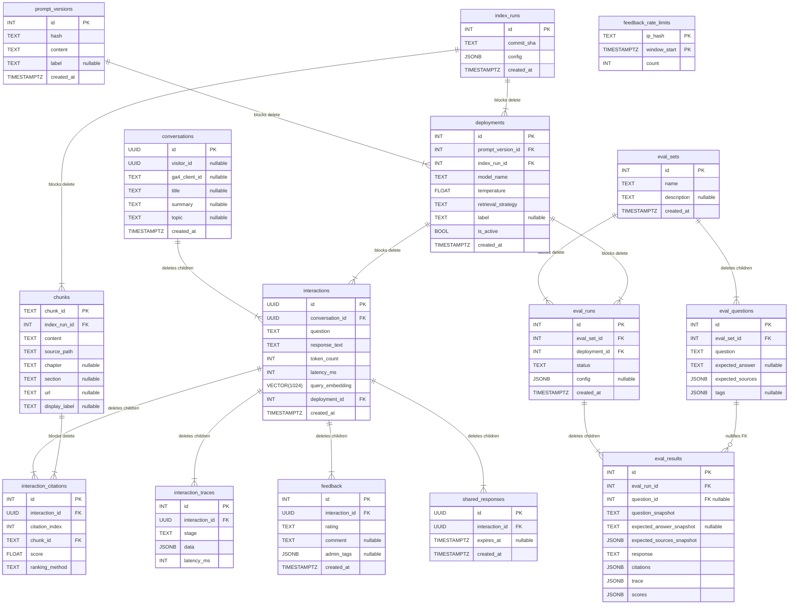
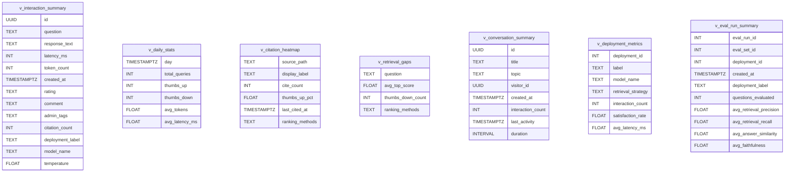

# Database Schema

PostgreSQL 17 + pgvector.
15 tables and 7 views in the `earthrise` schema.
Auto-generated from SQLAlchemy ORM models.
Regenerate with `uv run python scripts/generate_schema_diagram.py`.

## Tables

## Views

Pre-aggregated analytics and evaluation summaries.
Defined in Alembic migrations as raw SQL; mapped by read-only ORM models.

